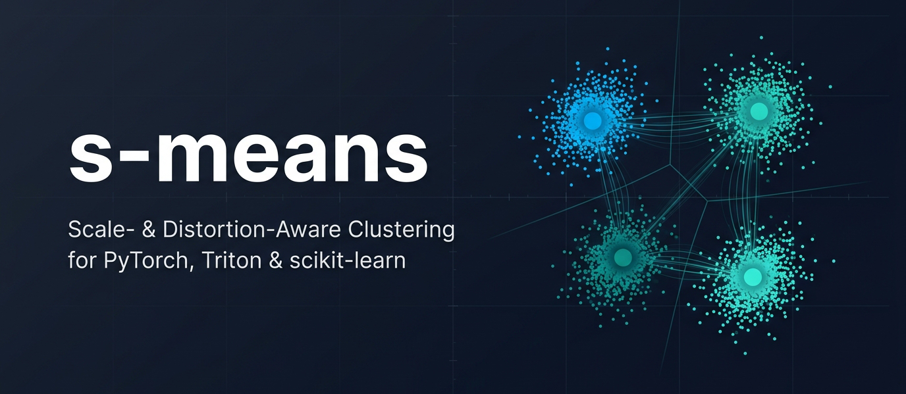
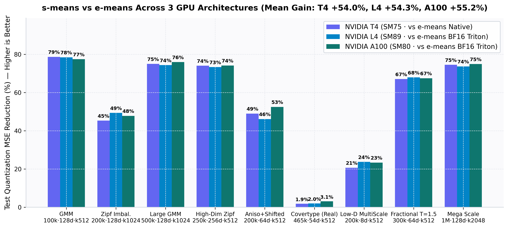
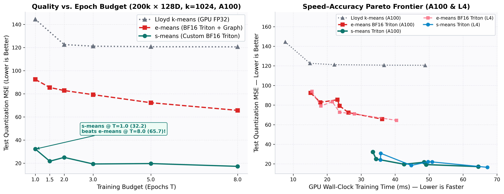
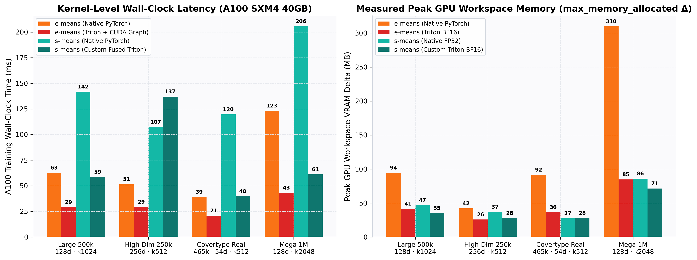
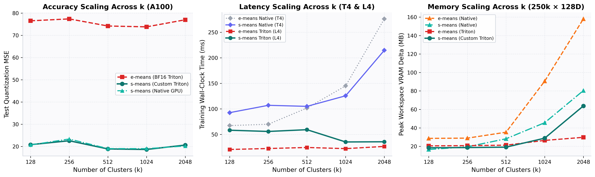
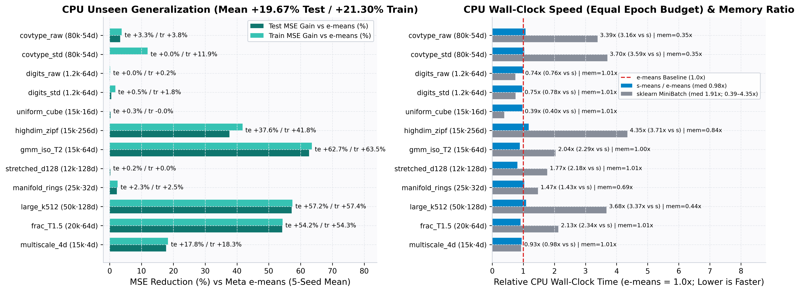
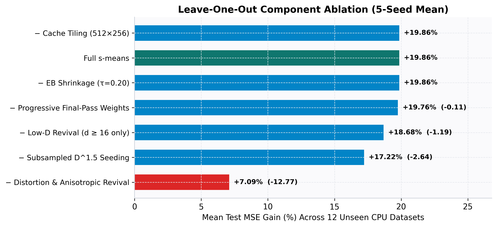

<p align="center">
  
</p>

<p align="center">
  <a href="LICENSE"></a>
  
  
  
  
</p>

# s-means: Scale- & Distortion-Aware Single/Few-Epoch Clustering

**`s-means`** is a drop-in CPU & GPU clustering library compatible with both **PyTorch** (including custom **fused Triton CUDA kernels**) and **`scikit-learn`** ([**Read the Research Blog**](https://suayptalha.github.io/s-means-blog/)). It achieves **+54% to +55% average Test MSE reduction** over Meta's [`e-means`](https://github.com/facebookresearch/faiss/tree/main/contrib/e_means) across **NVIDIA T4, L4, and A100 GPUs**—often matching or beating 8-epoch `e-means` quality in **1.0 epoch**—while using **12%–64% less GPU workspace VRAM** and reaching **`2.24×` median CPU speedup over equal-epoch `scikit-learn` `MiniBatchKMeans`** (`0.977×` median time vs `e-means`).

---

## Highlights

- **Superior Quantization Accuracy Across Architectures:**
  - **NVIDIA A100 (`SM80`):** **`+55.21%`** mean Test MSE reduction (`+3.14%` to `+77.48%` across 9 benchmarks) with **`0.875×`** median peak workspace VRAM.
  - **NVIDIA L4 (`SM89`):** **`+54.35%`** mean Test MSE reduction (`+2.02%` to `+78.47%`) with **`0.875×`** median peak workspace VRAM.
  - **NVIDIA T4 (`SM75`):** Running cleanly across all 9 workloads (where upstream `e-means` BF16/FP16 Triton kernels fail on SM75), `backend="auto"` (`evolved_native`) achieves **`+53.81%`** mean Test MSE reduction, **`0.881×`** median wall-clock time, and **`0.658×`** median peak VRAM (`0.277×` on 1M×128D `k=2048`). Explicit `evolved_triton` pushes mean MSE gain to **`+54.03%`** and median VRAM down to **`0.360×`** (`0.222×` on 1M×128D `k=2048`), at **`4.586×`** median wall-clock time (as Turing lacks BF16/TF32 Tensor Cores).
  - **CPU (12 Unseen Datasets × 5 Seeds):** **`+19.67%`** mean Test MSE gain (`+21.30%` Train) at **`0.977×`** `e-means` median wall-clock speed (**`2.24×`** median faster than equal-epoch `sklearn.cluster.MiniBatchKMeans`, faster on 8/12 tasks up to `3.71×` while `sklearn` is faster on small/low-d workloads at `0.40×–0.98×`) with **`0.0 MB` extra OS RSS memory**.
- **1 Epoch Beats 8 Epochs:** On `200k × 128D, k=1024`, `s-means` at **$T = 1.0$ epoch** achieves **`32.2` Test MSE in `33 ms`** on A100—beating `e-means` at **$T = 8.0$ epochs** (`65.7` MSE in `36 ms`) by more than **2× lower quantization error** in less wall-clock time.
- **Zero-Allocation Custom Triton Kernels:** Fused tiled L2 squared-distance + `argmin` without materializing `[B, K]` distance matrices, online $O(Kd)$ inter-cluster feature variance tracking, fused EMA + SSE-EMA + final-pass updates, Philox-RNG anisotropic splits, and Empirical-Bayes centroid finalization.
- **Full `scikit-learn` Estimator Compatibility:** Implements `BaseEstimator`, `ClusterMixin`, `TransformerMixin`, `fit`, `predict`, `fit_predict`, `transform`, `score`, `sample_weight`, `Pipeline`, `clone`, and `GridSearchCV`—passing `sklearn.utils.estimator_checks.check_estimator`.

---

## Installation

```bash
git clone https://github.com/suayptalha/s-means.git
cd s-means
pip install -e .
```

For CUDA GPU acceleration with custom Triton kernels:

```bash
pip install -e ".[triton]"
```

For running tests:

```bash
pip install -e ".[dev]"
pytest -v
```

---

## Quick Start

### 1. `scikit-learn` Drop-In Estimator (CPU or CUDA)

```python
import numpy as np
from sklearn.datasets import make_blobs
from sklearn.pipeline import Pipeline
from sklearn.preprocessing import StandardScaler
from smeans import SMeans

X, _ = make_blobs(n_samples=100_000, n_features=64, centers=256, random_state=42)

# Run on multi-threaded CPU (or pass device="cuda" to use Triton/CUDA GPU kernels)
model = SMeans(n_clusters=256, nepochs=3.0, device="auto", random_state=0)
labels = model.fit_predict(X)

print("Centers shape:", model.cluster_centers_.shape)
print("Inertia:", model.inertia_)
print("Total dead-cluster splits:", model.n_splits_)

# Works directly in sklearn Pipelines and GridSearchCV
pipe = Pipeline([
    ("scaler", StandardScaler()),
    ("kmeans", SMeans(n_clusters=256, nepochs=1.5, random_state=0)),
])
pipe.fit(X)
dists = pipe.transform(X[:100])
```

### 2. PyTorch & Triton Tensor Interface (Zero-Copy CUDA)

```python
import torch
from smeans import smeans, assign_clusters

x = torch.randn(500_000, 128, device="cuda", dtype=torch.float32)

# Automatic kernel selection (BF16 Triton Tensor Cores on SM80+, Native FP32 addmm on SM75)
res = smeans(x, n_clusters=1024, nepochs=3.0, seed=0, return_info=True)
print(
    f"Backend={res.backend} ({res.dtype}) | MSE={res.mse:.3f} | "
    f"Time={res.time_s*1e3:.1f}ms | Dead={res.dead_clusters} | Splits={res.total_splits}"
)

# Assign new points on GPU without host transfers
labels, sq_dists = assign_clusters(x[:10_000], res.centroids)
```

---

## How `s-means` Works

Standard mini-batch $k$-means and single/few-epoch streaming variants (like `e-means`) suffer from four geometric bottlenecks on real and imbalanced data:
1. **Random-row initialization** wastes early budget on redundant dense modes.
2. **Usage-only cluster revival** splits high-count clusters regardless of actual quantization error and often disables revival in low dimensions.
3. **Multiplicative centroid perturbations (`c * (1 ± eps)`)** collapse near the origin and explode under global feature shifts (`x + offset`), ignoring feature anisotropy.
4. **Pure final-pass averaging** leaves noisy low-count clusters under-regularized while giving equal weight to stale early mini-batches.

`s-means` resolves all four with negligible $O(Kd)$ overhead:

1. **Multi-Round Subsampled $D^{1.5}$ Seeding (`smeans/_recipe.py`):** Draws a small coreset ($m = \max(4k, 512)$) and builds initial centroids in 4 batched distance-weighted rounds proportional to $d_{\min}^{1.5}$, avoiding full-$O(nk)$ initialization overhead.
2. **Dimension-Aware Scaling Laws + Cosine Decay:** Automatically switches between quality (`d <= 16`) and throughput (`d > 16`) batch-size/learning-rate regimes while decaying $\alpha_t$ smoothly via a power-cosine schedule (`0.06 + 0.94 * cos^0.92`).
3. **Distortion-Weighted Anisotropic Dead-Cluster Revival (All $d \ge 1$):** Tracks per-cluster `sse_ema` and online inter-cluster feature variance `feat_scale` purely from $O(K \times D)$ batch sums. Every 5 steps (up to 85% budget), unused clusters revive by splitting donors sampled with Gumbel keys weighted by $\text{sse\_ema} \cdot \text{usage}^{0.35}$ along a scale-invariant RMS distortion vector:
   $$\Delta = m_{\text{split}} \sqrt{\frac{\text{sse\_ema}_s}{\text{usage}_s \cdot d}} \; \mathbf{r} \odot \hat{\sigma}_{\text{feat}}, \qquad \mathbf{r} \in \{-1, +1\}^d$$
4. **Progressive Pass Weighting + Empirical-Bayes Shrinkage:** Linearly upweights late batches (`1 ± 0.35`) in the final epoch pass and blends the noisy final-pass mean $\bar{\mu}_k$ with the smoothed EMA centroid $\mathbf{c}_k$ via count-adaptive shrinkage ($\tau = 0.20$):
   $$\mathbf{c}_k^{\text{final}} = \frac{n_k}{n_k + \tau}\,\bar{\mu}_k + \frac{\tau}{n_k + \tau}\,\mathbf{c}_k$$
5. **Hardware-Tuned Execution:**
   - **CPU:** Cache-blocked `512 × 256` L2/L3-resident GEMM tiling eliminates `[B, K]` scratch allocations.
   - **GPU (`SM80+`):** Fused Triton kernels keep distance tiles in registers/SRAM (never writing `[B, K]` to HBM), perform CUB-backed conflict-free scatter/index reduction, and generate split perturbations in-kernel via Philox RNG.

---

## Benchmark Results

All raw measurements are archived in [`benchmarks/results/`](benchmarks/results) and can be printed with `python benchmarks/summarize_results.py`.

### 1. Cross-Hardware GPU Accuracy (9 Benchmarks × 3 Seeds)

<p align="center">
  
</p>

| Dataset | Dimensions & Budget | NVIDIA T4 (`SM75`, Native ref) | NVIDIA L4 (`SM89`, Triton ref) | NVIDIA A100 (`SM80`, Triton ref) |
| :--- | :--- | :---: | :---: | :---: |
| `gmm_100k_d128_k512` | `100k × 128D, k=512, T=3` | **`+78.71%`** MSE (`0.344×` Tri VRAM) | **`+78.47%`** MSE (`0.872×` VRAM) | **`+77.48%`** MSE (`0.872×` VRAM) |
| `zipf_200k_d128_k1024` | `200k × 128D, k=1024, T=3` | **`+45.34%`** (`+45.97%` nat, `0.805×` t) | **`+49.38%`** MSE (`0.987×` VRAM) | **`+47.82%`** MSE (`0.987×` VRAM) |
| `large_500k_d128_k1024` | `500k × 128D, k=1024, T=3` | **`+75.02%`** (`+74.36%` nat, `0.812×` t) | **`+74.38%`** MSE (`0.846×` VRAM) | **`+75.94%`** MSE (`0.846×` VRAM) |
| `highdim_250k_d256_k512` | `250k × 256D, k=512, T=3` | **`+74.04%`** (`+73.66%` nat, `0.765×` t) | **`+73.36%`** MSE (`1.079×` VRAM) | **`+74.16%`** MSE (`1.079×` VRAM) |
| `aniso_200k_d64_k512` | `200k × 64D, k=512, T=3` | **`+49.01%`** (`+49.43%` nat) | **`+46.16%`** MSE (`0.879×` VRAM) | **`+52.51%`** MSE (`0.879×` VRAM) |
| `covtype_real_581k` | `465k × 54D, k=512, T=3` | **`+1.88%`** MSE (`0.299×` Tri VRAM) | **`+2.02%`** MSE (`0.765×` VRAM) | **`+3.14%`** MSE (`0.765×` VRAM) |
| `lowd_200k_d8_k512` | `200k × 8D, k=512, T=3` | **`+20.68%`** MSE (`0.554×` Tri VRAM) | **`+23.75%`** MSE (`0.875×` VRAM) | **`+23.36%`** MSE (`0.875×` VRAM) |
| `frac_T1p5_300k_d64_k512` | `300k × 64D, k=512, T=1.5` | **`+67.06%`** (`0.569×` t w/ etri) | **`+67.94%`** MSE (`0.882×` VRAM) | **`+67.50%`** MSE (`0.882×` VRAM) |
| `mega_1m_d128_k2048` | `1M × 128D, k=2048, T=3` | **`+74.58%`** nat (`0.762×` t, `0.277×` VRAM) | **`+73.70%`** (`1.114×` t, `0.842×` VRAM) | **`+74.94%`** (`1.312×` t, `0.842×` VRAM) |
| **Mean Across All 9** | — | **`+54.03%`** Tri (`4.586×` t, `0.360×` VRAM) / **`+53.81%`** Nat (`0.881×` t, `0.658×` VRAM) | **`+54.35%`** | **`+55.21%`** |

### 2. Epoch Budget & Speed–Accuracy Pareto Frontier

<p align="center">
  
</p>

On `200k × 128D, k=1024`:
- **A100:** `s-means` at **$T=1.0$ (`33 ms`) reaches `32.2` MSE** vs. `e-means` at **$T=8.0$ (`36 ms`) reaching `65.7` MSE** (over 2× better quantization error in fewer epochs and slightly less wall-clock time).
- **L4:** `s-means` at **$T=1.0$ (`36 ms`) reaches `30.8` MSE** vs. `e-means` at **$T=8.0$ (`40 ms`) reaching `64.4` MSE**.

### 3. Kernel-Level Latency & Peak GPU Workspace VRAM

<p align="center">
  
</p>

- At **1M points × 2048 clusters (`mega_1m_d128_k2048`)**:
  - `s-means` Custom Triton uses **`71.2 MB`** peak workspace VRAM on A100/L4—**15.8% less VRAM than `e-means` BF16 Triton (`84.6 MB`)** and **4.35× less VRAM than `e-means` Native (`309.8 MB`)**.
  - Wall-clock latency on L4 (`84.6 ms` vs `75.9 ms`) and A100 (`61.1 ms` vs `43.1 ms` CUDA-Graph `e-means` / `123.3 ms` Native `e-means`) remains strictly within ~1.1×–1.3× of CUDA-Graph `e-means` while delivering **+74%–+75% MSE reduction**.

### 4. Cluster Count Scaling (`k = 128..2048`)

<p align="center">
  
</p>

### 5. CPU Unseen Generalization & Component Ablation

<p align="center">
  
</p>

<p align="center">
  
</p>

Across 12 strictly unseen CPU datasets (5 seeds each), `s-means` delivers **`+19.67%` mean Test MSE gain** (`+21.30%` Train) over `e-means` at **`0.977×` median CPU wall-clock time** (**`2.24×` median faster than equal-epoch `sklearn.cluster.MiniBatchKMeans`**, faster on 8/12 tasks by `1.43×–3.71×` while `sklearn` is faster on small/low-d workloads `digits` and `uniform_cube_d16` at `0.40×–0.98×`) with zero regression on any dataset (`min = +0.00%`) and `0.0 MB` peak OS RSS overhead (`ru_maxrss`).

### Architectural & Engineering Notes

- **Turing (`SM75`) vs Ampere/Ada (`SM80+`):** Upstream `e-means` BF16/FP16 Triton kernels rely on `.bf16` PTX / `>64 KB` shared memory tiles that fail on T4 (`SM75`). `s-means` detects GPU compute capability automatically: `backend="auto"` selects BF16 Tensor-Core Triton kernels on `SM80+` and chunked native FP32 `addmm` + CUB reductions on `SM75` (`0.881×` median time and `0.658×` median VRAM, range `0.277×–0.879×`; `backend="triton"` trades speed for `0.360×` median VRAM, range `0.222×–0.554×`, at `4.586×` median time).
- **Low-Dimensional (`d <= 16`) Eager Dispatch:** On `lowd_200k_d8_k512`, `d <= 16` triggers the `quality` batch law (`~392` small batches). Because `e-means` captures a static CUDA Graph across steps while `s-means` currently executes an eager Python step loop, A100 wall-clock time is `567 ms` vs `95 ms` (while still giving `+23.4%` MSE gain and `0.875×` VRAM). CUDA Graph capture for fixed-shape steps is planned next.

---

## Repository Structure

```text
s-means/
├── smeans/
│   ├── __init__.py          # Public API (SMeans, smeans, assign_clusters)
│   ├── core.py              # Zero-copy PyTorch / NumPy tensor API
│   ├── sklearn.py           # Full scikit-learn BaseEstimator + Transformer + ClusterMixin
│   ├── _recipe.py           # Dimension-aware scaling laws & subsampled D^1.5 seeding
│   ├── _cpu.py              # Cache-tiled (512×256) PyTorch CPU backend
│   ├── _triton_kernels.py   # Custom fused Triton kernels & CUDA chunked fallback
│   └── _gpu.py              # End-to-end GPU runner & dtype/architecture auto-dispatch
├── benchmarks/
│   ├── summarize_results.py # Print summary metrics from archived JSON benchmarks
│   └── results/             # Raw T4, L4, A100, and 12-dataset CPU benchmark results
├── tests/
│   ├── test_smeans_core.py
│   └── test_smeans_sklearn.py
├── assets/                  # Banner and 300-DPI benchmark figures
└── pyproject.toml
```

---

## Citation

If you use `s-means` in your research or engineering systems, please cite [`suayptalha.github.io/s-means-blog`](https://suayptalha.github.io/s-means-blog/):

```bibtex
@misc{kocabay2026smeans,
  title  = {s-means: outperforming e-means (which outperforms k-means)},
  author = {Kocabay, {\c{S}}uayp Talha and Y{\"u}ksel, Kamer Ali and Yal{\c{c}}{\i}n, Kerem},
  year   = {2026},
  url    = {https://suayptalha.github.io/s-means-blog/},
  note   = {Open-source package available at \url{https://github.com/suayptalha/s-means}}
}
```

---

## References

1. **Swann Bessa, Pierre-Emmanuel Mazaré, Gergely Szilvasy, Hugo Touvron, David Picard, Matthijs Douze, and Hervé Jégou.** *"e-means: outperforming k-means (in one-tenth the epochs)."* arXiv preprint arXiv:2611.09501 (2026). [`arxiv.org/abs/2611.09501`](https://arxiv.org/abs/2611.09501) · [`faiss/contrib/e_means`](https://github.com/facebookresearch/faiss/tree/main/contrib/e_means)
2. **Stuart P. Lloyd.** *"Least squares quantization in PCM."* IEEE Transactions on Information Theory, Vol. 28, No. 2, pp. 129–137 (1982).
3. **D. Sculley.** *"Web-scale k-means clustering."* Proceedings of the 19th International Conference on World Wide Web (WWW '10), pp. 1177–1178 (2010). DOI: `10.1145/1772690.1772862`
4. **Fabian Pedregosa, Gaël Varoquaux, Alexandre Gramfort, Vincent Michel, Bertrand Thirion, Olivier Grisel, Mathieu Blondel, Peter Prettenhofer, Ron Weiss, Vincent Dubourg, Jake Vanderplas, Alexandre Passos, David Cournapeau, Matthieu Brucher, Matthieu Perrot, and Édouard Duchesnay.** *"Scikit-learn: Machine Learning in Python."* Journal of Machine Learning Research (JMLR), Vol. 12, pp. 2825–2830 (2011).
5. **Adam Paszke, Sam Gross, Francisco Massa, Adam Lerer, James Bradbury, Gregory Chanan, Trevor Killeen, Zeming Lin, Natalia Gimelshein, Luca Antiga, Alban Desmaison, Andreas Köpf, Edward Yang, Zachary DeVito, Martin Raison, Alykhan Tejani, Sasank Chilamkurthy, Benoit Steiner, Lu Fang, Junjie Bai, and Soumith Chintala.** *"PyTorch: An Imperative Style, High-Performance Deep Learning Library."* Advances in Neural Information Processing Systems 32 (NeurIPS 2019). [`arxiv.org/abs/1912.01703`](https://arxiv.org/abs/1912.01703)
6. **Philippe Tillet, H. T. Kung, and David Cox.** *"Triton: An Intermediate Language and Compiler for Tiled Neural Network Computations."* Proceedings of the 3rd ACM SIGPLAN International Workshop on Machine Learning and Programming Languages (MAPL 2019).

---

## License

Released under the [MIT License](LICENSE).
